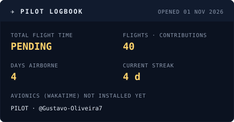

<h1 align="center">Gustavo Oliveira</h1> 
<b>Backend Developer</b> · Go &amp; Java/Spring Boot
 
  

### ✈️ Pre-flight briefing

- 🛫 Backend com **Go** (GCP, Kubernetes) no dia a dia e **Java/Spring Boot** nos projetos
- 🧭 Integrações com Google Merchant Center, Meta Ads, GA, VTEX e Salesforce
- ♟️ Também desenvolvo sistemas sob medida pela **Fianchetto Sistemas**

  

### 🛩️ Aircraft type ratings

        

### 📡 Contact the tower

<a href="https://gustavo-oliveira7.github.io">Portfolio</a> · <a href="https://www.linkedin.com/in/gustavo-oliveira7/">LinkedIn</a>

O avião e o logbook são gerados por um programa em Go deste repositório (<code>cmd/flightlog</code>), rodando numa GitHub Action a cada 6 horas.
